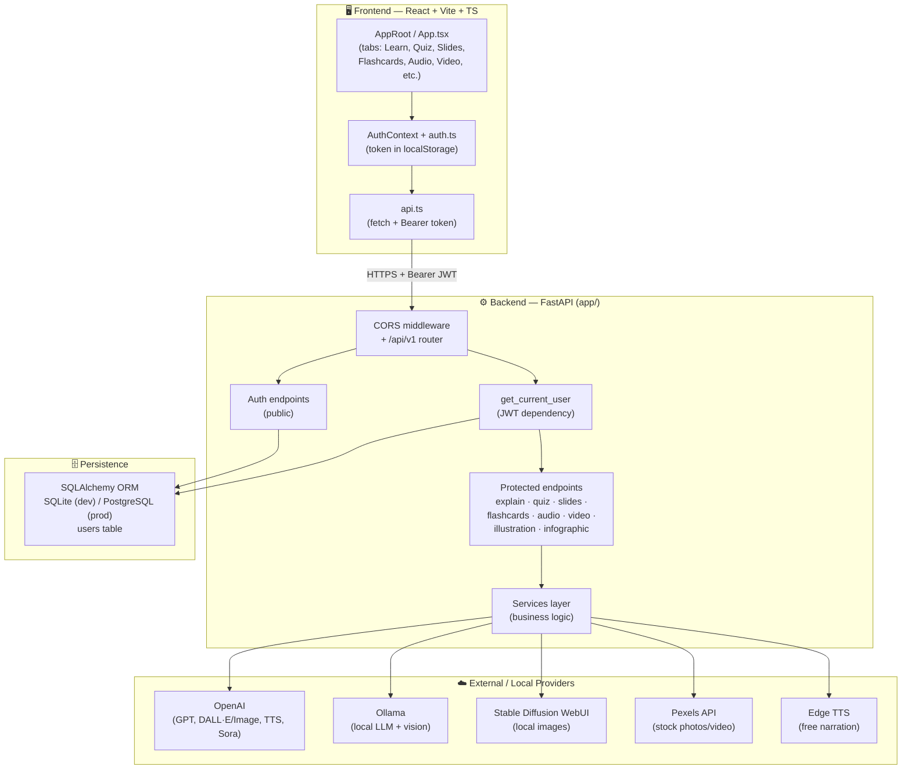
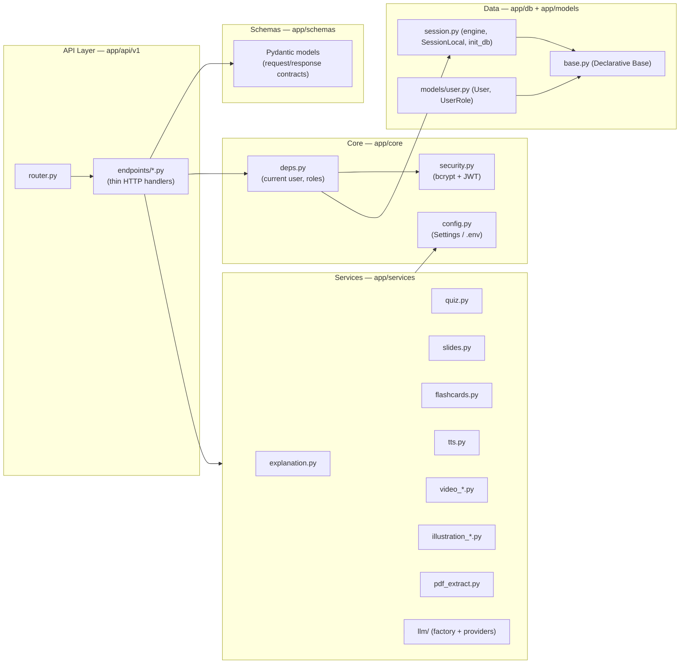
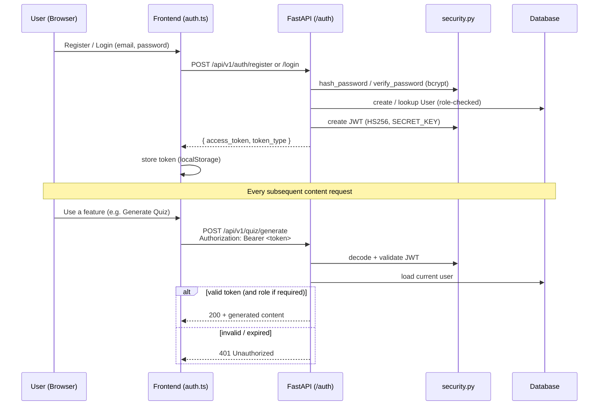
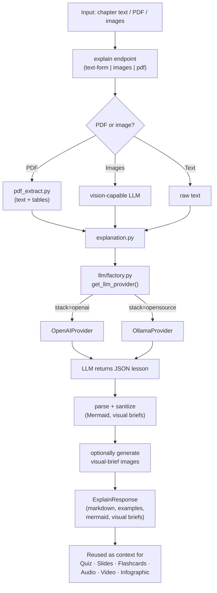
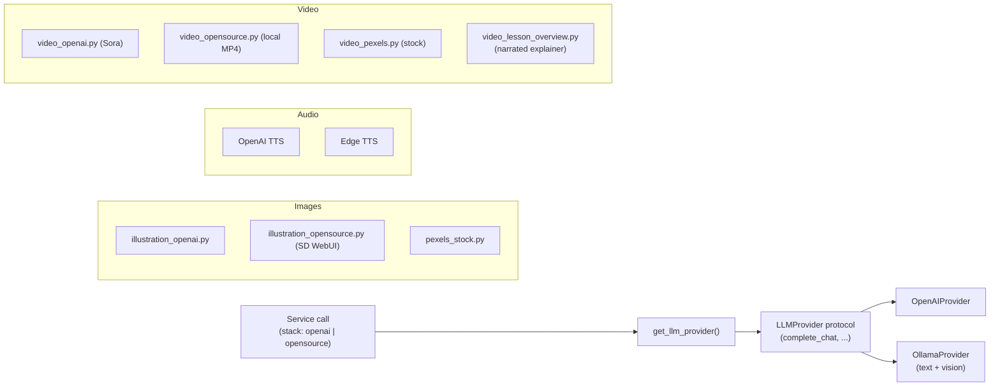

# ClassroomAI — Architecture Overview

A brief, end-to-end architecture of the ClassroomAI project: an AI-powered
educational content generator that turns chapter text, PDFs, or screenshots into
explanations, quizzes, slides, flashcards, audio, video, illustrations, and
infographics — all behind JWT-secured, role-based accounts.

---

## 1. High-Level System

---

## 2. Backend Layered Architecture

The backend follows a clean, layered structure under `app/`:

**Responsibilities**

| Layer | Path | Role |
|-------|------|------|
| API | `app/api/v1/` | HTTP routing; auth routes public, everything else guarded by `get_current_user` |
| Schemas | `app/schemas/` | Pydantic request/response validation and contracts |
| Core | `app/core/` | Settings (`config.py`), password hashing + JWT (`security.py`), DI dependencies (`deps.py`) |
| Services | `app/services/` | All business logic and provider integrations |
| Data | `app/db/`, `app/models/` | SQLAlchemy engine/session, declarative base, `User` model |
| Entry | `app/main.py` | FastAPI app, CORS, startup `init_db()` + admin bootstrap |

---

## 3. Authentication & Authorization Flow

- **Roles:** `teacher`, `student`, `course_creator`, `admin` (`UserRole` enum).
- Public registration allowed for non-admin roles; admins created via
  `BOOTSTRAP_ADMIN_*` settings on startup or `scripts/init_db.py`.
- Admin-only endpoints (e.g. list users) enforce a role check on top of auth.

---

## 4. Content Generation Pipeline (Learn flow example)

The generated explanation/context text is reused across the other modules, so a
single source produces a full lesson package.

---

## 5. Provider Abstraction (pluggable AI backends)

Every feature picks a provider at runtime via a `stack` parameter
(`openai` vs `opensource`) and the `llm/factory.py` factory:

This keeps each capability swappable between **cloud (OpenAI)**, **local/free
(Ollama, Stable Diffusion, Edge TTS, local animation)**, and **stock (Pexels)**.

---

## 6. API Surface (v1)

| Group | Endpoint(s) | Auth |
|-------|-------------|------|
| Auth | `POST /auth/register`, `POST /auth/login`, `GET /auth/me`, `GET /auth/users` (admin) | public / token |
| Explain | `POST /explain/text`, `/explain/text-form`, `/explain/image`, `/explain/images`, `/explain/pdf` | Bearer |
| Quiz | `POST /quiz/generate` | Bearer |
| Slides | `POST /slides/generate`, `GET /slides/{id}/file` (.pptx) | Bearer |
| Flashcards | `POST /flashcards/generate` | Bearer |
| Audio | `POST /audio/speech`, `GET /audio/{id}/file` (.mp3) | Bearer |
| Video | `POST /video/jobs`, `GET /video/jobs/{id}`, `GET /video/jobs/{id}/file` | Bearer |
| Illustration | `POST /illustration` | Bearer |
| Infographic | `POST /infographic/generate` | Bearer |
| System | `GET /` (root), `GET /health` | public |

All routes are mounted under the `/api/v1` prefix. The frontend (Vite dev server)
proxies `/api` to the backend.

---

## 7. Technology Stack

**Backend:** FastAPI · Pydantic (+ pydantic-settings) · SQLAlchemy ·
python-jose (JWT) · bcrypt · python-pptx · pdfplumber · imageio · edge-tts ·
OpenAI SDK · Ollama.

**Frontend:** React · Vite · TypeScript · Mermaid (diagram rendering) · Axios/fetch.

**Persistence:** SQLite by default (`classroom_ai.db`), PostgreSQL for production
via `DATABASE_URL`.

**Config:** `.env` (real secrets, gitignored) layered over `.env.example`,
loaded by `app/core/config.py`.

---

## 8. Request Lifecycle (summary)

1. User authenticates → receives a JWT, stored client-side.
2. Frontend `api.ts` attaches `Authorization: Bearer <token>` to every call.
3. FastAPI router routes the request; protected routes run `get_current_user`.
4. The endpoint validates input via a Pydantic schema and calls a service.
5. The service selects a provider through `llm/factory.py` and does the work
   (LLM call, image/audio/video generation, PPTX build, etc.).
6. Results return as JSON, or as downloadable files (PPTX/MP3/MP4) via a
   second `GET .../file` request for job-style outputs.
